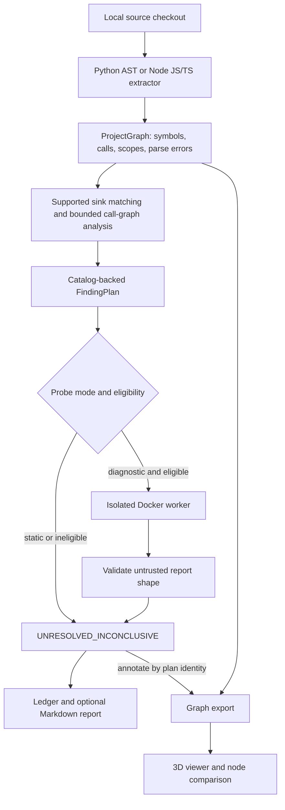

# Architecture

Sentinel-Zero separates source resolution, evidence collection, disposition
authority, and presentation. The CLI and MCP server share one analysis
pipeline. Static analysis is the default; diagnostic execution is optional
and cannot turn target-produced data into independent verification.

## Pipeline

An unresolved call remains visible in the graph but does not automatically
produce a finding plan. Plans require a resolved call matching a supported
sink. Unsupported or unrecognized APIs therefore cannot be ruled safe by
an empty plan list.

## Components

| Component | Responsibility |
| --- | --- |
| `graph.py` | Language-neutral `ProjectGraph`, symbols, unresolved targets, call sites, functions, and wrapper relationships |
| `resolvers/python_resolver.py` | Python AST indexing, lexical bindings, nested scopes, method receivers, call evidence, and bounded branch paths |
| `source_inputs.py` | Contained regular-file source reads with an 8 MB byte cap; not a parser execution sandbox |
| `resolvers/js_resolver.py` and `resolvers/js/extract_graph.js` | Node AST extraction for JS/TS and translation into the same graph model |
| `callgraph.py` | Cycle-safe delegation, external-package reachability, and competing sink-site counts |
| `catalog_loader.py` | Typed catalog document validation, including IDs/aliases and metadata shape |
| `disposition.py` and `schema_check.py` | Catalog resolution, plan construction, required fields, status transitions, and serialization authority |
| `dogfood_scan.py` | Resolver selection, sink classification, guard evidence, optional diagnostics, and artifact orchestration |
| `probes/container_runner.py` | Shared mandatory Docker boundary, fixed environment, bounded output, and lifecycle handling |
| `probes/evidence.py` | Allowlisted report shape validation; no proof authentication |
| Python and JS harnesses | In-container diagnostic recorders around supported operations |
| `ledger_writer.py` | Path-confined, byte-capped UTF-8 writes |
| `graph_export.py` | Serialize the graph and attach finding identifiers/statuses without re-analyzing it |
| `cli.py` and `mcp_server.py` | Command-line and stdio MCP transports over the same orchestrator |
| `scan_diff.py` | Compare retained finding lists by stable UID and disposition |
| `viewer/` | Validate and render graph exports; filter, inspect, and compare nodes |

All Python component paths above are relative to `sentinel_zero/`.
The graph is the Interprocedural Symbol & Binding Graph (ISBG); it is a
bounded static representation, not a complete execution trace.

## Resolution and analysis

Resolvers index supported functions before resolving calls across project
modules. Python child functions receive qualified names such as
`mod.outer.<locals>.second`; sibling definitions are bound before child
bodies are inspected. Parameter/local shadowing and modeled rebindings
must not manufacture a sibling edge. JS/TS handles supported direct inline
function and arrow callback arguments as separate scopes.

Argument labels are `literal`, `parameter`, `unknown`, `traced:literal`,
or `traced:parameter`. They describe bounded syntactic evidence, including
selected one-hop call expressions, not whole-program attacker dataflow.

Guard analysis combines source order, resolver branch paths, structural
raise/return shapes, and delegated guards. A guard-shaped call does not
establish that its condition rejects the relevant attacker input. Loop,
exception, dynamic dispatch, and higher-order semantics remain bounded;
see [analysis limits](isbg-limits.md).

Sink kinds map to ASI IDs in the orchestrator. Names and classification
metadata are resolved from the selected catalog at plan construction.
The bundled snapshot uses the same loader and is explicitly identified
by `catalog.is_bundled_snapshot`.

## Authority and diagnostics

Current findings stay `UNRESOLVED_INCONCLUSIVE`. `PENDING` is an internal
construction state. Both `set_disposition` and `FindingPlan.as_dict`
reject verified statuses without an independent verifier, including
attempts to assign a verified state directly into a plan dictionary.

Docker provides an execution boundary, not report authenticity. Workers
can fabricate their own output and mutate their own serializers. The
parent supplies the requested site and records reports as target-controlled
with `site_verified: false`. Report fields cannot supply authority.
Competing same-symbol sites are counted transitively before diagnostic
eligibility is considered. [Security](SECURITY.md) documents the full boundary.

## Output contracts

`verification_ledger.json` contains repository identity, probe mode, summary
counts, finding plans, wrapper information, external dependency counts,
parse errors, `analyzed_files`, coverage, and catalog provenance. Each plan includes hypothesis,
verification method, execution gate, disposition, per-run `plan_id`, and
stable `finding_uid`.

`graph.json` has `schema_version: 2`, `target_repository`, node/edge counts,
`nodes`, and `edges`. Module/function node IDs use `module:` and `function:`
prefixes while `qualified_name` preserves the original symbol. Resolved call
edges retain `target_symbol` and `target_kind`; external endpoints use
`external:` IDs rather than aliasing a project node. Module ownership is
derived from physical source files, including methods and nested functions.
Module/function nodes and call edges carry finding plan IDs,
finding UIDs, and their worst attached disposition. Unresolved call edges
retain a reason. This export is a serialization of the analyzed graph and
plans, not a second classifier. The viewer consumes this graph, not the ledger.
It validates required consumer types, unique IDs and endpoint consistency
before replacing the displayed graph. Unambiguous historical schema 1 graphs
remain readable; duplicate legacy identities require a fresh export.

Artifacts are written individually; failed later writes are not an atomic
rollback of earlier files. Parse errors and failed diagnostics can be
represented in otherwise completed analyses. [Usage](../USAGE.md) explains
how consumers should interpret completion and partial evidence.

## Comparison

Library diffing compares finding UIDs and disposition changes. The viewer
compares nodes using disposition and attached finding-UID sets. Neither
comparison re-runs analysis. There is no scan-history service, scheduler,
or `sentinel-zero diff` CLI subcommand. See
[scan comparison](SECURITY_MONITORING.md) for the current API and limits.
