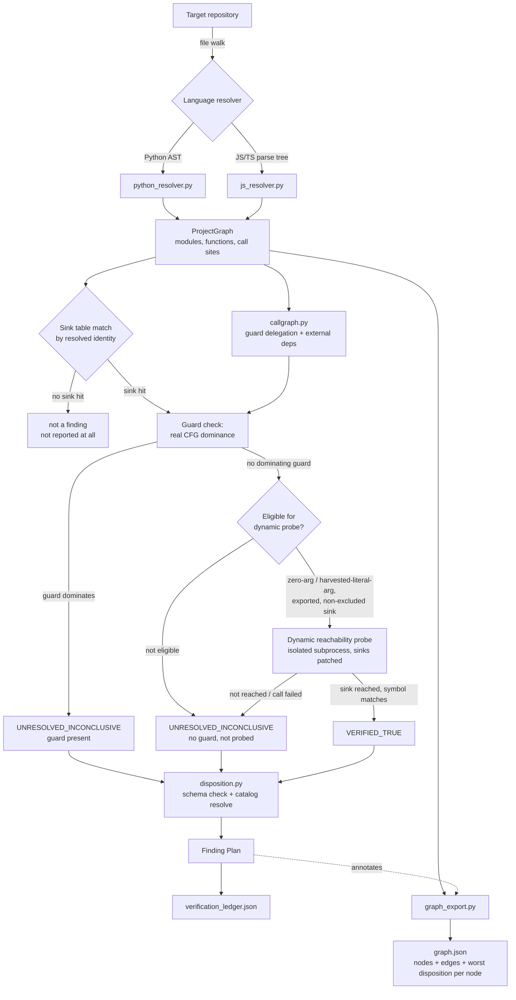

# Sentinel-Zero — Architecture

**Status:** living document, kept current as of Milestone 22 (scan-to-scan
diffing, both the engine's `scan_diff.py` and the 3D viewer's node-level
diff view — see `docs/SECURITY_MONITORING.md` §2-3). If a milestone in `README.md` changes
how data moves through the system, this document must be updated in the
same change — an architecture doc that drifts from the code is worse than
no architecture doc, because it is trusted and wrong.

## 1. What this system is

Sentinel-Zero is a static-plus-bounded-dynamic source-code analyzer. Given
a repository, it finds calls into a small set of known-dangerous
operations ("sinks" — process execution, file I/O, deserialization),
resolves each call's real identity (not a name/string match), checks
whether a resolved, structurally-real guard provably runs on every path
to that sink, and — for a narrow, safety-bounded subset of findings —
actually calls the containing function in an isolated subprocess to
confirm the sink really is reached. Every finding that comes out the
other end is a **Finding Plan**: a schema-checked, attack-class-tagged
record with an explicit disposition and an explicit reason for that
disposition. Nothing is reported as a "finding" without passing through
the one disposition authority (`disposition.py`).

## 2. Design principles (why it's built this way)

These are the three invariants established early in this project and
enforced structurally, not by convention:

1. **No silent tool failure.** A step that was supposed to run and didn't
   (a resolver crash, a catalog that can't be loaded) is a hard
   `TOOL_FAILURE` that halts the run. It is never absorbed into a quiet
   pass or a "findings: 0" result that looks clean.
2. **Live ASI catalog only.** Every attack-class ID a Finding Plan cites
   is resolved against a real, loaded catalog export at report time.
   There is no hardcoded attack-class label table anywhere in the engine.
   An ID the catalog doesn't recognize is a hard error (`UnknownAttackClass`),
   never a silent pass-through to a stale or guessed label.
3. **A Finding Plan is required for every reported hypothesis.** A raw
   observation ("this line calls `os.system`") is not a finding until it
   has gone through `schema_check.require_finding_plan_fields` and been
   given an explicit disposition with a reason. There is no code path
   that can report a bare, un-reviewed observation as if it were a
   decision.

A fourth, narrower invariant governs the one place this tool touches a
real process: **the dynamic reachability probe never executes real
target code outside its own bounded, patched sandbox.** It is explained
in full in §5.

## 3. Components

| Component | Responsibility |
|---|---|
| `sentinel_zero/graph.py` | The language-agnostic IR (ISBG — Interprocedural Symbol & Binding Graph). No Python- or JS-specific logic lives here; this is the contract every resolver must populate. |
| `sentinel_zero/resolvers/python_resolver.py`, `resolvers/js_resolver.py` (+ `resolvers/js/extract_graph.js`) | One resolver per language. Each walks that language's real AST/parse tree and populates the ISBG — resolving imports, aliases, class-method dispatch, and (Python) real CFG dominance for guard detection. Nothing downstream needs to know which language produced a given graph. |
| `sentinel_zero/callgraph.py` | Bounded, cycle-safe project-wide call-graph walks: does a function resolve as guard-shaped through delegation; what external packages does a function transitively reach. |
| `sentinel_zero/catalog_loader.py` | Loads and indexes a real ASI (Agent Security Index) catalog export — live or a bundled point-in-time snapshot, always labeled as to which. |
| `sentinel_zero/disposition.py` | The one disposition authority. Builds and schema-validates a Finding Plan, resolves its attack-class ID against the loaded catalog, and sets its status (`VERIFIED_TRUE`, `VERIFIED_FALSE`, `UNRESOLVED_INCONCLUSIVE`, `TOOL_FAILURE`). |
| `sentinel_zero/schema_check.py` | Validates every required Finding Plan field is present before anything downstream can see it. |
| `sentinel_zero/probes/` | The bounded dynamic reachability probe (Python + JS/TS mirrors). Runs the target's own containing function, in an isolated subprocess, with every known sink patched to a recorder that raises before the real operation executes. Can only ever argue *for* `VERIFIED_TRUE`. |
| `sentinel_zero/dogfood_scan.py` | The orchestrator. Wires a resolver, its sink table, the guard/dominance check, the dynamic probe, and the ledger writer together into one run. |
| `sentinel_zero/ledger_writer.py` | Path-confined, size-capped file writer — the only thing that puts a ledger or graph export on disk. |
| `sentinel_zero/graph_export.py` | Serializes the in-memory graph as `graph.json` — nodes + edges, annotated with which Finding Plan touches each one. Pure re-serialization; never a second, independently-computed view of a disposition. |
| `sentinel_zero/cli.py`, `sentinel_zero/mcp_server.py` | The two transports: the `sentinel-zero` console command, and the `sentinel-zero-mcp` MCP server tool (`analyze_repository`). Both call the same `dogfood_scan.run()` — no separate logic. |

## 4. Data flow

Two outputs come out of one run, from the same in-memory graph, never
recomputed independently of each other:

- **`verification_ledger.json`** — the flat list of Finding Plans. This is
  the audit trail: every hypothesis that was actually investigated, with
  its disposition and the reason for that disposition. As of Milestone 21,
  each plan also carries a `finding_uid` — a stable identity derived from
  `(source_node, sink_node)`, independent of the per-run sequential
  `plan_id` — which is what makes `sentinel_zero/scan_diff.py` possible
  (see §7 below).
- **`graph.json`** — the full node/edge graph (every module, every
  function, every resolved *and* unresolved call — far more than what
  made it into the ledger), with each node/edge annotated by which
  Finding Plan(s) touch it (both `finding_plan_ids` and, since Milestone
  21, the stable `finding_uids`) and that node's *worst* disposition.
  This is the data the `viewer/` 3D renderer (Milestone 20-22) consumes —
  the ledger alone cannot reconstruct it, because the ledger only keeps
  calls that reached a known sink.

## 5. The dynamic reachability probe's safety model

This is the one place the system runs anything beyond static analysis, so
its safety boundary is stated explicitly and tested directly, not assumed:

- The probe only ever calls the **real, exported function the static
  resolver already found** — nothing is synthesized, no adversarial input
  is ever constructed or guessed at.
- It runs in an **isolated subprocess** (`python -I` / `node`), never in
  the process doing the scanning, with a hard wall-clock timeout.
- Before importing/requiring the target module, it **patches every known
  sink to a recorder that raises before the real operation runs** — so
  even a reached sink never actually executes (no real subprocess is
  spawned, no real file is written, no real deserialization happens).
- It **never patches a function the language's own module-loading
  machinery depends on** (`builtins.eval`/`exec` in Python; `fs.readFileSync`
  in Node) — confirmed empirically for each language before either
  harness was written, not assumed by symmetry between the two. A
  finding whose own sink *is* one of these two is never probed at all.
- A probe result can only ever **promote toward `VERIFIED_TRUE`** — a
  sink not reached on one run proves nothing about other inputs, so
  `not_reached` / `call_failed` leave the disposition exactly as static
  analysis already set it. The probe never argues for `VERIFIED_FALSE`.
- The probe patches every known sink **simultaneously** and reports
  whichever fires first — so a disposition engine consuming its result
  must check the reported symbol matches the *specific* finding's own
  sink identity before promoting (`_promote_if_sink_reached`). This was a
  real, confirmed bug (Milestone 16) before this check existed.

## 6. What this is not (see `docs/USE_CASES.md` for the full list)

This is a source-code reachability analyzer, not a runtime security
product. It does not monitor live traffic, does not fuzz a running
target, and is not a substitute for a human review of anything it
reports as `UNRESOLVED_INCONCLUSIVE` — which, as of this milestone, is
still most of what it finds. See §6 of `USE_CASES.md` for the explicit,
disallowed-use-case list.

## 7. Stable finding identity, scan diffing, and the 3D viewer

Two additions sit on top of the pipeline in §4, consuming its output
without changing it:

- **`sentinel_zero/scan_diff.py`** (Milestone 21) compares two
  `verification_ledger.json` plan lists by `finding_uid` and classifies
  every finding as new, removed, changed-disposition, or unchanged. Pure
  comparison, no re-analysis — see `docs/SECURITY_MONITORING.md` §2-3 for
  the full design and what's still only proposed (a scan-history index,
  a CLI subcommand).
- **`viewer/`** (Milestone 20, filtering/diffing added in Milestone 22)
  is a standalone Three.js application that loads `graph.json`, lays it
  out in 3D with a small dependency-free force simulation, and renders
  it — color-coded by disposition, filterable by category/name with
  one-hop path context, and able to diff two loaded `graph.json`
  documents node-by-node using the same `finding_uids` `scan_diff.py`
  uses at the ledger level. It is a separate, independent codebase (its
  own `package.json`, its own test runner) with no dependency on any
  other visualizer in this account's portfolio — see `viewer/README.md`.
